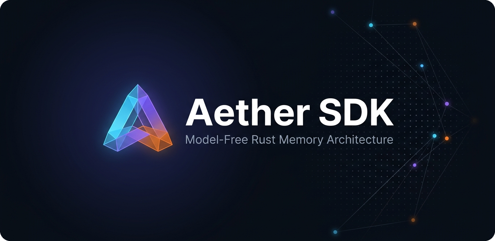
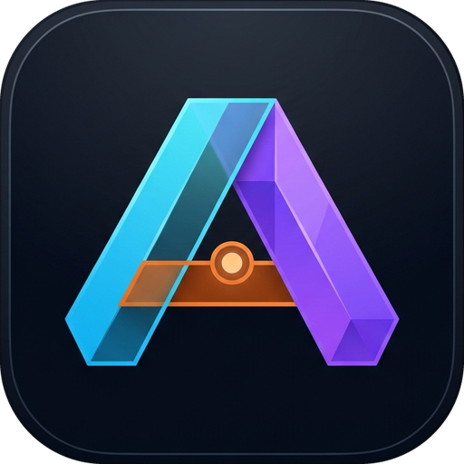
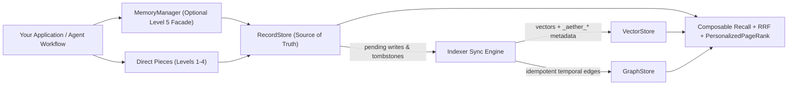

<div align="center">



<br />



# Aether SDK

**Model-free, pieces-first Rust memory SDK for AI agents and applications.**  
Unify authoritative record storage, derived vector indexes, and temporal knowledge graphs without lock-in.

[](https://github.com/muninn-hq/aether-sdk/actions/workflows/ci.yml)
[](https://github.com/muninn-hq/aether-sdk/actions/workflows/docs.yml)
[](LICENSE)
[](Cargo.toml)

[Website](https://muninn-hq.github.io/aether-sdk/) · [Documentation](https://muninn-hq.github.io/aether-sdk/docs) · [Architecture](docs/architecture/index.md) · [Get started](docs/get-started/quickstart.md) · [Rust usage guide](docs/sdk/usage.md) · [Storage Providers](#storage-providers) · [Quickstart](#quickstart)

</div>

---

## Why Aether SDK?

Keeping **records**, **dense vectors**, and **graph facts** consistent across crashes, concurrent writes, updates, and deletes is where most agent memory stacks break. **Aether SDK** solves consistency at the storage boundary while staying strictly **model-free**: you bring your own embeddings, entities, and workflow logic, and adopt only the pieces you need.



- **Record Store as System of Record**: `MemoryItem` truth lives in `RecordStore` (`create`, atomic `idempotency_key`, CAS `cas_update`, versioned `tombstone`, and TTL-bound `session_items`).
- **Crash-Safe Derived Indexes**: `VectorStore` and `GraphStore` are derived from `RecordStore` pending state via `Indexer::run_pass()` or opt-in background `Indexer::spawn(...)`.
- **Strong Scopes & Honesty Guarantees**: `MemoryScope::User(UserId)` isolates user data; `MemoryScope::Session(SessionId)` stays strictly inside the TTL-enforced record store; `ReadYourWrites` scores unflushed records using the exact index `DistanceMetric`.
- **Resilience Out of the Box**: Compose `Batcher` -> `Timeout` -> `Resilient` (exponential backoff with full `jittered` delay) -> `Traced` around any backend.

---

## Five Composable Levels

Start with a raw connector or adopt the full facade. Every higher level is built solely from public APIs below it.

| Level | Component | Role | Example |
| :--- | :--- | :--- | :--- |
| **Level 1** | Storage Connectors (`muninn-aether-core`, `muninn-aether-adapters`) | Call `RecordStore`, `VectorStore`, or `GraphStore` directly | [`level_1_connector.rs`](crates/aether-sdk/examples/level_1_connector.rs) |
| **Level 2** | Middleware Stack (`muninn-aether-adapters`) | Wrap any driver with `Batcher`, `Timeout`, `Resilient`, `Traced` | [`level_2_middleware.rs`](crates/aether-sdk/examples/level_2_middleware.rs) |
| **Level 3** | Recall Primitives (`muninn-aether-cortex::recall`, `ppr`) | Compose `vector_search`, `graph_search`, `rrf`, `PersonalizedPageRank` | [`level_3_hybrid_recall.rs`](crates/aether-sdk/examples/level_3_hybrid_recall.rs) |
| **Level 4** | Sync Engine (`muninn-aether-cortex::Indexer`) | Derive vector and graph indexes from durable `RecordStore` cursors | [`level_4_sync_engine.rs`](crates/aether-sdk/examples/level_4_sync_engine.rs) |
| **Level 5** | Orchestration Facade (`muninn-aether-sdk::MemoryManager`) | One builder (`remember`, `recall`, `update`, `forget`, `flush`, `shutdown`) | [`level_5_facade.rs`](crates/aether-sdk/examples/level_5_facade.rs) |

---

## Workspace Crates

| Crate | Purpose |
| :--- | :--- |
| **`muninn-aether-core`** | Pure domain DTOs, validated newtypes (`ProjectId`, `MemoryId`, `EntityId`, `UserId`, `SessionId`), `IndexSpec`, `DistanceMetric::score`, `FilterExpr::matches`, `AetherError`, and storage traits. |
| **`muninn-aether-cortex`** | Composable [`Indexer`](crates/aether-cortex/src/indexer.rs) sync engine, [`PersonalizedPageRank`](crates/aether-cortex/src/ppr.rs) + `graph_scores`, and [`recall`](crates/aether-cortex/src/recall.rs) retrieval & RRF primitives. |
| **`muninn-aether-adapters`** | `InMemoryBackend` (`in_memory` with `FaultPoint` injection), middleware decorators, reusable [`contract`](crates/aether-adapters/src/contract.rs) test suite (`contract-suite`), and 7 backend drivers. |
| **`muninn-aether-sdk`** | Public `MemoryManager` / `MemoryManagerBuilder` composition root, runnable examples, and optional OpenTelemetry OTLP preset (`otel`). |
| **`muninn-aether-vault`** | Obsidian-native vault daemon (`VaultEngine`), SQLite WAL (schema `v3`) + FTS5 + `PersonalizedPageRank` + `CrossEncoderReranker` recall, `DenseSubwordEmbedder` / `LocalGpuEmbedder`, `.aetherhot` / `.aetherignore` path rules, `dream_watermarks` consolidation, `Aether/Inbox.md` -> `Aether/Compiled/Approved.md` mirror, per-agent scoped API keys, Git team sync with monotonic lattice reconciliation, vLLM/SGLang + LMCache KV-tensor warming, authenticated `ControlPlaneServer` (with `GET /v1/openapi.json`), and `aether-mcp` (`--init`, `--install-clients`, `doctor`, `--http-only`, scoped `stdio` MCP). |

---

## Storage Providers

All drivers implement `OutboundConnector` + the same [`contract`](crates/aether-adapters/src/contract.rs) suite and are enabled individually via Cargo feature flags on `muninn-aether-adapters`.

| Role | Provider | Feature Flag | Highlights |
| :--- | :--- | :--- | :--- |
| **Record** | **SQLite (WAL)** | `sqlite` | Embedded ACID persistence, schema auto-migration, monotonic `seq_counter` |
| **Record** | **Redis / Valkey** | `redis` | Atomic Lua `create` / `cas_update` / `tombstone` / `mark_indexed`, sub-ms TTL |
| **Vector** | **Qdrant** | `qdrant` | REST search/filter translation (`Eq`/`In`/`Range`/`And`/`Or`), persisted `describe()` |
| **Vector** | **pgvector** | `pgvector` | Parameterized `sqlx` queries, `_specs` table persistence across restarts |
| **Vector** | **Chroma v2** | `chroma` | Tenant/database collections, HNSW metric validation, `describe()` recovery |
| **Vector** | **Turbopuffer** | `turbopuffer` | Batch HTTP upsert/query, strict filter validation |
| **Graph** | **Neo4j** | `neo4j` | Query API v2, temporal bounds (`valid_at` / `invalid_at`), idempotent relations |
| **All Roles** | **In-Memory** | *(default)* | Zero-infra `InMemoryBackend` with `FaultPoint` failure injection for fast tests |

---

## Quickstart

### 1. Run Offline Tests & Examples

```bash
# Run the full offline test suite across all workspace crates and mocked drivers
cargo test --workspace --all-features

# Run each SDK level example
cargo run -p muninn-aether-sdk --example level_1_connector
cargo run -p muninn-aether-sdk --example level_2_middleware
cargo run -p muninn-aether-sdk --example level_3_hybrid_recall
cargo run -p muninn-aether-sdk --example level_4_sync_engine
cargo run -p muninn-aether-sdk --example level_5_facade
cargo run -p muninn-aether-sdk --example otel_demo --features otel
```

### 2. Use `MemoryManager` in Rust

```rust
use std::sync::Arc;
use muninn_aether_adapters::InMemoryBackend;
use muninn_aether_core::{
    DistanceMetric, Entity, EntityId, MemoryInput, ProjectId, RecallMode, RecallQuery, Relation,
    VectorStore, WriteDurability,
};
use muninn_aether_sdk::MemoryManager;
use chrono::Utc;

#[tokio::main]
async fn main() -> muninn_aether_core::Result<()> {
    let backend = Arc::new(InMemoryBackend::new());
    let project_id = ProjectId::new("my-project")?;
    backend.initialize(&project_id, 3, DistanceMetric::Cosine).await?;

    let manager = MemoryManager::builder(backend.clone())
        .vector(backend.clone())
        .graph(backend)
        .build();

    let alice = Entity {
        id: EntityId::new("person:alice")?,
        name: "Alice".into(),
        entity_type: "Person".into(),
    };
    let mut input = MemoryInput::new(project_id.clone(), "Alice stores memories in Qdrant.");
    input.embedding = Some(vec![1.0, 0.0, 0.0]);
    input.durability = WriteDurability::WaitFlush;
    input.entities = vec![alice.clone()];
    input.relations = vec![Relation {
        source: alice.id.clone(),
        target: EntityId::new("db:qdrant")?,
        relation_type: "USES".into(),
        valid_at: Utc::now(),
        invalid_at: None,
    }];
    manager.remember(input).await?;

    let mut query = RecallQuery::new(project_id, "Where does Alice store memories?");
    query.query_vector = Some(vec![1.0, 0.0, 0.0]);
    query.seed_entities = vec![alice.id];
    query.mode = RecallMode::Hybrid;

    let result = manager.recall(query).await?;
    println!("Hits: {}, Subgraph edges: {}", result.hits.len(), result.subgraph.edges.len());

    manager.shutdown().await?;
    Ok(())
}
```

### 3. Run the Obsidian Vault MCP Server (`aether-mcp`)

Point `aether-mcp` at a local or shared Git-backed Obsidian vault (defaults to `~/.aether/vault` when `--vault` is omitted) to serve newline-delimited JSON-RPC 2.0 over `stdin` and `stdout` with `aether_recall`, `aether_stage_memory`, and `aether_inspect_source`. Use `--init` to install [`obsidian-aether-plugin/`](obsidian-aether-plugin/) and generate your `mcp.json` snippet, `--install-clients` to auto-configure detected Cursor, Claude Desktop, Claude Code, and Antigravity clients, `doctor` to verify the setup, `--http-only` to run `ControlPlaneServer` standalone without keeping `stdin` open, `--require-auth` for bearer authentication, and `GET /v1/openapi.json` to import into Custom GPT Actions or Open WebUI.

```bash
# Quickest local install (macOS / Linux) + auto-configure MCP clients
curl -fsSL https://raw.githubusercontent.com/muninn-hq/aether-sdk/main/scripts/install.sh | sh
aether-mcp --init --install-clients --vault /path/to/obsidian-vault
aether-mcp doctor --vault /path/to/obsidian-vault

# 1. Or build & run from source: install plugin and print mcp.json snippet
cargo run -p muninn-aether-vault --bin aether-mcp -- \
  --init --install-clients --vault /path/to/obsidian-vault --http-addr 127.0.0.1:14771

# 2. Standalone HTTP daemon for Obsidian (stays running until Ctrl-C / SIGTERM)
cargo run -p muninn-aether-vault --bin aether-mcp -- \
  --vault /path/to/obsidian-vault --http-addr 127.0.0.1:14771 --http-only

# 3. Team gateway mode with bearer authentication, scoped stdio MCP, and vLLM/LMCache KV warming
cargo run -p muninn-aether-vault --bin aether-mcp -- \
  --vault /path/to/team-obsidian-vault \
  --db /path/to/aether.sqlite \
  --watch-ms 2000 \
  --http-addr 0.0.0.0:4771 \
  --require-auth \
  --bootstrap-admin-key "$AETHER_BOOTSTRAP_ADMIN_KEY" \
  --api-key "$AETHER_API_KEY" \
  --kv-endpoint http://127.0.0.1:8000 \
  --kv-model llama-3.1-8b
```

See the [Vault & MCP Architecture](docs/architecture/m1-vault-mcp-rationale.md), [Memory Model](docs/sdk/memory.md), and [Usage Guide](docs/sdk/usage.md) for frontmatter tiers, `.aetherhot`, `.aetherignore`, `Aether/Inbox.md` approvals, Git team sync, scoped API keys, KV-cache warming, OpenAPI discovery, and the Obsidian companion plugin.

### 4. Run Live Docker Verification (Optional)

Spin up the local backing stores with [`scripts/dev-infra.sh`](scripts/dev-infra.sh) (see [`infra/README.md`](infra/README.md) for ports and credentials), then execute the `#[ignore]` live driver and end-to-end `MemoryManager` suites:

```bash
cp .env.example .env
./scripts/dev-infra.sh up

# Run live provider contract tests and multi-backend MemoryManager E2E tests
cargo test -p muninn-aether-adapters --all-features -- --ignored --test-threads=1
cargo test -p muninn-aether-sdk --all-features --test live_docker -- --ignored --test-threads=1
```

---

## Development Gate

Every PR must pass formatting, strict Clippy lints, offline workspace tests, and the Docusaurus site build:

```bash
cargo fmt --all --check
cargo clippy --workspace --all-targets --all-features -- -D warnings
cargo test --workspace --all-features
cd website && npm run build
```

---

## Documentation & License

- **Documentation Portal**: [`docs/index.md`](docs/index.md) · [`website/`](https://muninn-hq.github.io/aether-sdk/)
- **Observability & OpenTelemetry**: [`docs/sdk/observability.md`](docs/sdk/observability.md)
- **Engineering Rules & Guidelines**: [`AGENTS.md`](AGENTS.md) · [`docs/development/guidelines.md`](docs/development/guidelines.md) · [`CONTRIBUTING.md`](CONTRIBUTING.md)
- **License**: Apache 2.0 ([`LICENSE`](LICENSE))
