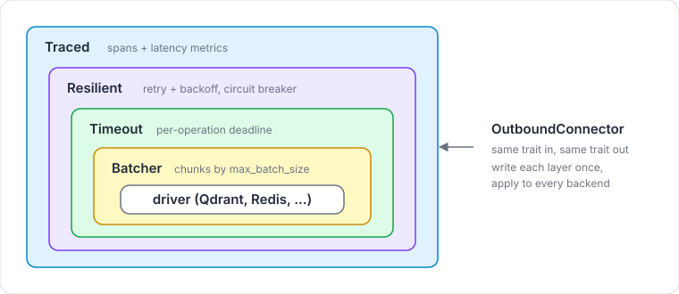

# Connectors Architecture (Unified Storage Layer)

`aether-adapters` provides the outbound storage traits' implementations so applications can combine **SQLite, Redis/Valkey, Turbopuffer, Qdrant, Chroma, pgvector, and Neo4j** behind consistent async traits, resilience wrappers, and contract tests.

---

## 1. Storage Roles & Connector Traits

Aether separates the authoritative system of record from derived search indexes:

- **`RecordStore: OutboundConnector`**: Authoritative durable store for `MemoryItem` records, atomic idempotency (`create`), batch lookup (`get_many`), optimistic CAS (`cas_update`), versioned tombstones (`tombstone`), indexing cursors (`pending`, `pending_for`, `mark_indexed`), and live TTL-backed `session_items`. Backed by **SQLite** (WAL mode) or **Redis/Valkey**.
- **`VectorStore: OutboundConnector`**: Derived dense vector + metadata index (`initialize`, `describe`, `upsert_batch`, `delete`, `search`) backed by **Turbopuffer, Qdrant, Chroma, or pgvector**. `describe` reports `Option<IndexSpec>` (dimensions and distance metric) for boundary checks.
- **`GraphStore: OutboundConnector`**: Derived temporal knowledge graph (`upsert_entities`, `upsert_relations`, `retract_memory_facts`, `neighborhood`) backed by **Neo4j** Query API v2 with `source_memory_id` provenance and `valid_at` / `invalid_at` bounds.

---

## 2. Crate & Module Structure (`aether-adapters`)

```text
crates/aether-adapters/
├── Cargo.toml           # Features: contract-suite, sqlite, redis, turbopuffer, qdrant, neo4j, chroma, pgvector
└── src/
    ├── lib.rs
    ├── contract.rs      # Reusable backend contract suite (gated by `contract-suite`)
    ├── in_memory.rs     # InMemoryBackend + FaultPoint injection
    ├── middleware.rs    # Batcher, Timeout, Resilient (exponential backoff + jitter), Traced
    ├── kv/              # sqlite.rs, redis.rs
    └── storage/         # turbopuffer.rs, qdrant.rs, neo4j.rs, chroma.rs, pgvector.rs
```

---

## 3. Shared Supertrait & Middleware Composition



Every driver implements `OutboundConnector` and composes cleanly inside generic middleware (`Traced<Resilient<Timeout<Batcher<T>>>>`):

```rust
#[derive(Debug, Clone)]
pub struct ConnectorCapabilities {
    pub max_batch_size: usize,
    pub supports_temporal: bool,
    pub supports_filter_expr: bool,
}

#[async_trait::async_trait]
pub trait OutboundConnector: Send + Sync {
    fn name(&self) -> &'static str;
    fn capabilities(&self) -> ConnectorCapabilities;
    async fn health_check(&self) -> Result<ConnectorHealth>;
    async fn close(&self) -> Result<()>;
}
```

### Error Classification & Wrapper Responsibilities

Drivers classify failures via `AetherError`:
- **`AetherError::Transient { .. }`**: Retryable transport or rate-limit errors (HTTP 429/503, timeouts, busy locks).
- **`AetherError::Permanent { .. }` / `InvalidInput` / `Conflict` / `NotFound`**: Non-retryable errors.

When stacked (which `MemoryManager::builder` configures by default, with opt-out toggles):
1. **`Batcher`** (vector store): chunks `upsert_batch` calls to `capabilities().max_batch_size`.
2. **`Timeout`**: bounds per-request tail latency (default 10s in `MemoryManager`).
3. **`Resilient`**: retries only `AetherError::is_retryable()` errors with full-jitter exponential backoff (`jittered`).
4. **`Traced`**: emits `connector_op` `tracing` spans with `otel.kind = "client"`, `db.system`, `connector`, `project_id`, `op`, and `otel.status_code`.

---

## 4. Contract Test Suite

Every storage implementation is verified against `aether_adapters::contract::{record_store, record_store_concurrent_idempotency, vector_store, graph_store}`:
- **Record contract**: `create`, atomic `idempotency_key` deduplication (concurrent + persisted state), namespace isolation, `cas_update` conflict checks, TTL expiration, `session_items`, `tombstone` + key reuse, and `mark_indexed`.
- **Vector contract**: namespace isolation, `describe` across clients/restarts, `upsert_batch` + `delete` idempotency, dimension mismatch rejection, distance metrics, and `FilterExpr` translation (`Eq`, `In`, `Range`, `And`, `Or`).
- **Graph contract**: entity/relation idempotent upserts, temporal `as_of` / `active_only` filtering, multi-hop `neighborhood` traversal, and `retract_memory_facts` provenance isolation.
