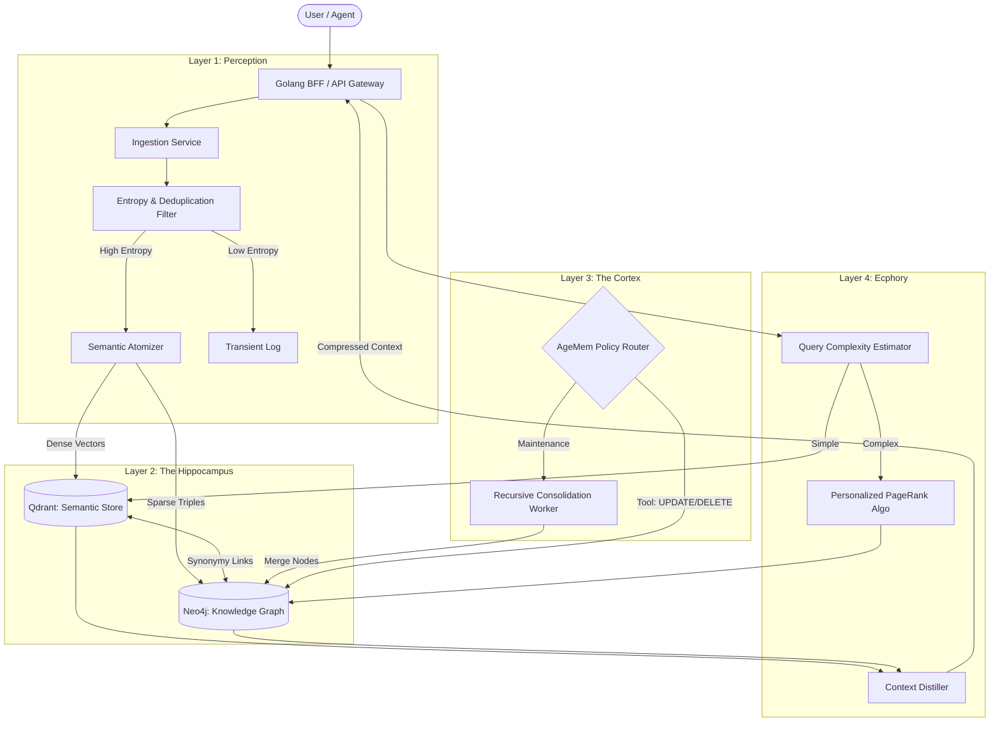

This document serves as the comprehensive architectural specification for **Project Aether** (Nytheris.AI). It synthesizes the neurobiological principles of **HippoRAG**, the active management policies of **AgeMem**, and the compression efficiency of **SimpleMem** into a unified commercial memory layer.

---

# **Project Aether: Neuro-Symbolic AGI Memory Architecture**
**Version:** 1.0 (MVP)
**Status:** Design Phase
**Core Philosophy:** Memory is not a passive storage bucket; it is an active, metabolic process of filtering, structuring, and reconstructing information.

---

## **1. Theoretical Foundation**

Our architecture is grounded in three core cognitive theories derived from recent research. These theories dictate *why* we build the components the way we do.

### **1.1. Complementary Learning Systems (CLS) & Hippocampal Indexing**
*   **Theory:** Human memory relies on two distinct systems: the **Neocortex** (slow learning, structured knowledge) and the **Hippocampus** (fast learning, pattern separation). The hippocampus creates an "index" of unique events (episodic memory) that points back to the neocortex,.
*   **Application:** We do not store raw text in a single pile. We create a **Knowledge Graph (Hippocampus)** that acts as a relational index pointing to **Vector Embeddings (Neocortex/Parahippocampal)**. This allows "Pattern Completion"—retrieving a whole memory from a partial cue.

### **1.2. The Entropy Gating Hypothesis**
*   **Theory:** Human working memory has a limited capacity. We naturally filter out "low-entropy" signals (phatic communication like "Hello", "Okay") and only encode high-density information.
*   **Application:** We implement an **Entropy Filter** at the ingestion layer. Data is only stored if it introduces new entities or significantly diverges semantically from the immediate history, preventing "Context Inflation".

### **1.3. Memory as Action (Agentic Control)**
*   **Theory:** Memory is not just retrieval; it is active management. Humans actively decide to "remember this for later" or "forget that, it changed".
*   **Application:** We treat memory operations (`ADD`, `UPDATE`, `DELETE`) as **Tools** exposed to the AI agent, governed by a Reinforcement Learning (RL) policy rather than hard-coded heuristics.

---

## **2. High-Level Architecture (The "Aether Polyglot")**

The system follows a **Polyglot Microservices** pattern, utilizing Go for high-concurrency I/O and Python for logic-heavy AI processing.



---

## **3. Component Deep Dive**

### **Layer 1: Perception (Ingestion & Compression)**
**Goal:** Prevent "garbage in, garbage out" by filtering noise before it hits the database.

*   **Component: Entropy Filter (SimpleMem)**
    *   **Logic:** Calculates the information density ($H(W_t)$) of incoming text relative to the session history.
    *   **Formula:** $H(W_t) = \alpha \cdot \frac{|E_{new}|}{|W_t|} + (1-\alpha) \cdot (1 - \cos(E(W_t), E(H_{prev})))$.
    *   **Action:** If $H(W_t) < \tau$ (threshold), the input is discarded or flagged as "Transient".
*   **Component: Semantic Atomizer (De-linearization)**
    *   **Logic:** Converts conversational flow (which is messy) into "Atomic Facts."
    *   **Process:**
        1.  **Coreference Resolution:** Replaces "he," "it," "that project" with specific names ("John," "Project Alpha").
        2.  **Temporal Anchoring:** Converts "next Friday" to `2025-10-24` (ISO-8601).
    *   **Output:** Self-contained JSON objects ready for indexing.

### **Layer 2: The Hippocampus (Hybrid Storage)**
**Goal:** Store information in a format that supports both fuzzy search and logical reasoning.

*   **Dense Store (Qdrant/Milvus):**
    *   Stores **Passage Embeddings** (chunks of text) and **Entity Embeddings** (names of people/concepts),.
    *   **Role:** The "Parahippocampal Region" that detects synonymy (e.g., "NY" $\approx$ "New York").
*   **Sparse Graph (Neo4j/Graphiti):**
    *   Stores the **Topology** of memory.
    *   **Nodes:** Entities (People, Places) and *Passage Nodes* (the actual source text),.
    *   **Edges:**
        *   *Relation Edges:* (Alice)-[WORKS_ON]->(Project A).
        *   *Temporal Edges:* (Fact A)-[VALID_FROM]->(2025-01-01).
        *   *Context Edges:* (Entity)-[APPEARS_IN]->(Passage).

### **Layer 3: The Cortex (Policy & Maintenance)**
**Goal:** Keep the memory healthy and autonomous.

*   **Component: AgeMem Policy Router**
    *   **Logic:** An LLM-based controller that views memory operations as **Tools**,.
    *   **Tools:**
        *   `ADD`: Commit new atomic facts to the Graph.
        *   `UPDATE`: Detect conflicts (e.g., user changed preference) and overwrite old graph nodes.
        *   `DELETE`: Prune obsolete data to reduce graph noise.
*   **Component: Recursive Consolidation (The "Sleep" Cycle)**
    *   **Logic:** Asynchronous worker that runs when the user is inactive.
    *   **Function:** Scans the graph for clusters of similar nodes (e.g., 5 separate notes about "Coffee") and merges them into a single "Abstract Node" (User Habit: Coffee).

### **Layer 4: Ecphory (Adaptive Retrieval)**
**Goal:** Retrieve *only* what is needed, minimizing token cost.

*   **Component: Query Complexity Estimator**
    *   **Logic:** Classifies user query into "Lookup" (Simple) or "Reasoning" (Complex).
*   **Strategy A: Fast Path (Vector Only)**
    *   Used for simple lookups. Retrieves Top-K chunks from Qdrant. Latency < 200ms.
*   **Strategy B: Deep Path (Graph Traversal / HippoRAG)**
    *   Used for multi-hop reasoning (e.g., "How does the CEO's new mandate affect our Q3 engineering budget?").
    *   **Algorithm:** **Personalized PageRank (PPR)**. It uses the vector search results as "Seed Nodes" and spreads probability across the graph to find hidden connections (e.g., CEO $\to$ Mandate $\to$ Engineering $\to$ Budget),.
*   **Component: Context Distiller**
    *   **Logic:** Takes the retrieved subgraph and text chunks, and uses a small LLM (e.g., GPT-4o-mini) to synthesize a coherent summary *before* sending it to the user's main agent. This reduces token costs by up to 30x.

---

## **4. Data Schema (Implementation Details)**

To support the "Polyrepo" structure (Go BFF + Python Brain), we use a shared schema.

### **4.1. The Atomic Entry (JSON Contract)**
Passed from Ingestion to Storage.
```json
{
  "uuid": "mem_12345",
  "content": "Alice agreed to meet Bob at Starbucks on 5th Ave.",
  "timestamp": "2025-11-20T14:00:00Z", 
  "entities": [
    {"name": "Alice", "type": "PERSON"},
    {"name": "Bob", "type": "PERSON"},
    {"name": "Starbucks", "type": "LOCATION"}
  ],
  "source_id": "file_pdf_99",
  "vectors": [0.12, 0.98, ...] // Computed by Embedding Service
}
```
*Ref: SimpleMem Atomic Entry.*

### **4.2. Graph Schema (Neo4j)**
*   **Nodes:** `(:Entity)`, `(:Passage)`, `(:Event)`
*   **Relationships:**
    *   `(:Entity)-[:MENTIONED_IN]->(:Passage)` (Dense-Sparse Link).
    *   `(:Entity)-[:RELATED_TO {weight: 0.9}]->(:Entity)` (extracted relation).
    *   `(:Entity)-[:SAME_AS]->(:Entity)` (Synonymy edge).

---

## **5. Integration Strategy (Delivery)**

### **5.1. Model Context Protocol (MCP)**
We implement an **MCP Server** that exposes our retrieval layer as tools to clients like Claude Desktop.
*   **Tools Exposed:**
    *   `search_memory(query)`: Triggers the Hybrid Retrieval pipeline.
    *   `add_memory(text)`: Manually injects a fact into the graph.

### **5.2. Chrome Extension (Inject)**
*   **Mechanism:** Uses the "Naive Paste" strategy for free users and the "Brain Mode" (API call to our Distiller) for Pro users.
*   **Flow:** Extension detects ChatGPT $\to$ Injects "Context Sidebar" $\to$ User selects Project $\to$ Extension fetches `High-Density Context String` $\to$ Pastes into prompt.

---

## **6. Strategic Differentiation**

*   **Vs. Vector-Only RAG:** We solve the "Multi-Hop" problem using HippoRAG's graph traversal.
*   **Vs. Raw Context (Gemini 1M):** We solve the "Cost/Latency" problem using SimpleMem's compression, reducing token usage by 90%.
*   **Vs. Static Graphs:** We solve "Staleness" using AgeMem's active `UPDATE`/`DELETE` policy, keeping the graph distinct from a write-once database.

---

## **7. SDK Architecture Evolution**

To support this Neuro-Symbolic architecture while maintaining backward compatibility, we will evolve the `aether-sdk` structure using a "Core vs. Cortex" separation.

### **7.1. Co-existence Strategy**
We will retain the current `adapters` and `protocols` as the **Core Foundation**. The new architecture will be implemented as a higher-level **Cortex Layer** that consumes these core primitives.

*   **`aether_sdk.core`**: (Existing) Primitives, Protocols, and Basic Adapters (Qdrant, OpenAI).
*   **`aether_sdk.cortex`**: (New) The Neuro-Symbolic implementation (Layers 1-4).

### **7.2. Proposed Directory Structure**
```text
src/aether_sdk/
├── core/                # << STABLE FOUNDATION
│   ├── protocols.py     # Interfaces (VectorStore, GraphStore)
│   └── ...
├── adapters/            # << SHARED INFRASTRUCTURE
│   ├── qdrant/          # Vector DB Adapter
│   ├── neo4j/           # Graph DB Adapter (New)
│   └── litellm/         # LLM Adapter
├── cortex/              # << NEW "BRAIN" IMPLEMENTATION
│   ├── __init__.py
│   ├── perception/      # Layer 1: Ingestion & Filtering
│   │   ├── entropy.py   # Entropy Filter
│   │   └── atomizer.py  # Semantic Atomizer
│   ├── memory/          # Layer 2: Hippocampus
│   │   ├── episodic.py  # Vector wrappers
│   │   └── semantic.py  # Graph wrappers
│   ├── executive/       # Layer 3: Policy & Maintenance
│   │   ├── policy.py    # AgeMem Router
│   │   └── consolidation.py # Sleep cycle
│   └── ecphory/         # Layer 4: Retrieval
│       ├── planner.py   # Query Complexity Estimator
│       └── ppr.py       # Personalized PageRank
└── brain.py             # << FACADE (Unified Access)
```

### **7.3. Migration Path**
1.  **Phase 1 (Scaffolding):** Create the `cortex/` directory structure and abstract base classes.
2.  **Phase 2 (Adapters):** Implement missing adapters (Neo4j, Graphiti) in `adapters/`.
3.  **Phase 3 (Components):** Port logic into `cortex/` submodules.
4.  **Phase 4 (Unification):** Expose `AetherBrain` in `brain.py` which initializes the Cortex stack.

### **7.4. Usage Example (New API)**
```python
from aether_sdk import AetherBrain
from aether_sdk.adapters import QdrantAdapter, Neo4jAdapter

# Initialize Core Adapters
vector_db = QdrantAdapter(...)
graph_db = Neo4jAdapter(...)

# Initialize the Neuro-Symbolic Brain
brain = AetherBrain(
    vector_store=vector_db,
    graph_store=graph_db,
    policy="standard" # 'aggressive', 'conservative'
)

# Ingest (Layer 1)
await brain.perceive("The user, Alice, is working on Project Aether.")

# Retrieve (Layer 4)
context = await brain.recall("What is Alice working on?", strategy="hybrid")
```
