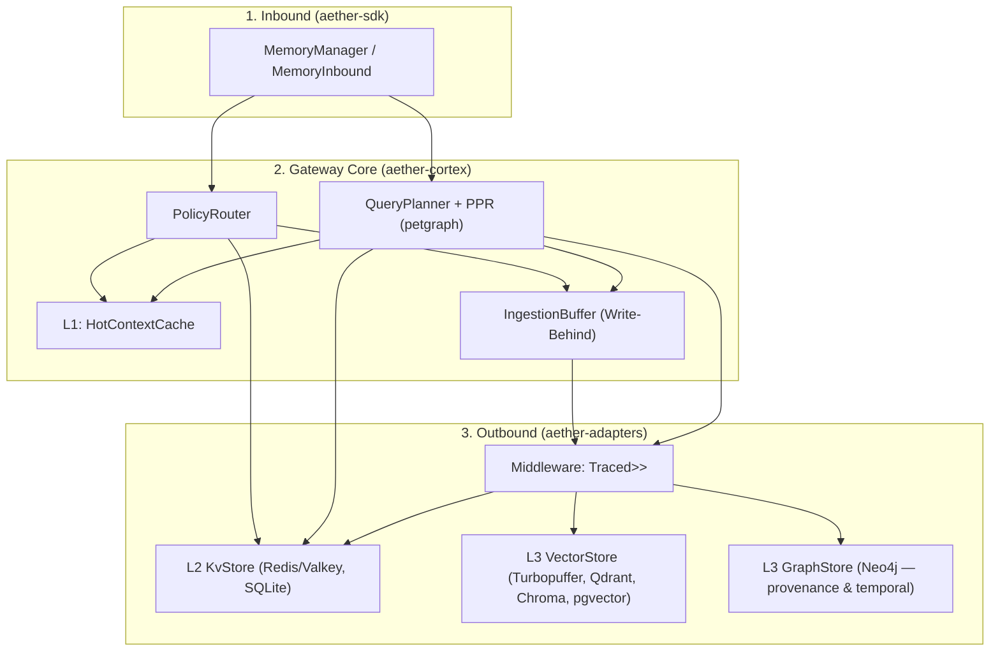

# Aether SDK Architecture

Aether SDK is a hexagonal, protocol-driven **AI Memory Gateway** in Rust. It decouples agent memory orchestration from specific storage and database engines so you can swap or combine **Redis/Valkey, SQLite, Turbopuffer, Neo4j, Qdrant, Chroma, and pgvector** without changing application logic.

:::note Shape is changing
This page describes the code as it is today, where `MemoryManager` is the single entry point.
The [pieces-first SDK design](./sdk-design.md) makes every component below usable on its own and turns `MemoryManager` into an optional facade.
:::

## High-Level Architecture

## Workspace Crates

1. **`aether-core`**: Pure domain contracts (`ProjectId`, `MemoryId`, `EntityId`, `FilterExpr`, `TemporalFilter`, `MemoryInbound`, `OutboundConnector`, `KvStore`, `VectorStore`, `GraphStore`).
2. **`aether-cortex`**: Orchestration core (`PolicyRouter`, `HotContextCache`, `IngestionBuffer`, `PersonalizedPageRank`, `QueryPlanner`).
3. **`aether-adapters`**: Shared outbound middleware (`Traced`, `Resilient`, `Timeout`, `Batcher`), `InMemoryBackend` for tests/dry-runs, and feature-gated production storage drivers.
4. **`aether-sdk`**: Public non-generic `MemoryManager` facade with CAS updates, `ReadYourWrites` consistency, and graceful `flush()` / `shutdown()`.
