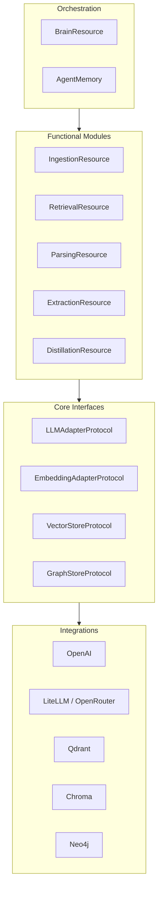

# Aether SDK Architecture

Aether SDK is a modular, protocol-driven framework for building intelligent agents with persistent memory and knowledge graph capabilities.

## High-Level Architecture

The system is designed with a layered approach, ensuring that core logic is decoupled from specific provider implementations.

## System Layers

### 1. Orchestration Layer
- **BrainResource**: The high-level interface for Question Answering. It orchestrates context retrieval and answer distillation.
- **AgentMemory**: Manages different memory types—Working (volatile), Episodic (semantic vector-based), and Semantic (graph-based).

### 2. Resource Layer
Functional modules that handle specific tasks:
- **Ingestion**: Manages the pipeline of parsing, chunking, and storing documents.
- **Retrieval**: Performs hybrid search across vector and graph stores.
- **Parsing**: Converts various file types into clean text.
- **Extraction**: Uses LLMs to extract entities and relations for the Knowledge Graph.
- **Distillation**: Refines retrieved context into a final answer.

### 3. Protocol Layer
Pure interface definitions that allow for plug-and-play integrations. Every component interacts with external services (LLMs, Databases) only via these protocols.

### 4. Adapter Layer
Concrete implementations of protocols for specific services (e.g., `OpenAIAdapter`, `QdrantAdapter`).

## Data Flow

### Ingestion Flow
1. **Document** is received.
2. **Parser** extracts text.
3. **Chunker** splits text into manageable pieces.
4. **Embedder** generates vectors for chunks.
5. **Vector Store** saves vectors and metadata.
6. **Extractor** pulls entities/relations (optional).
7. **Graph Store** saves the knowledge structure (optional).

### Query Flow
1. **User Query** is received.
2. **Embedder** vectorizes the query.
3. **Retriever** performs a vector search + optional graph traversal.
4. **Distiller** (LLM) generates an answer using the retrieved context.
