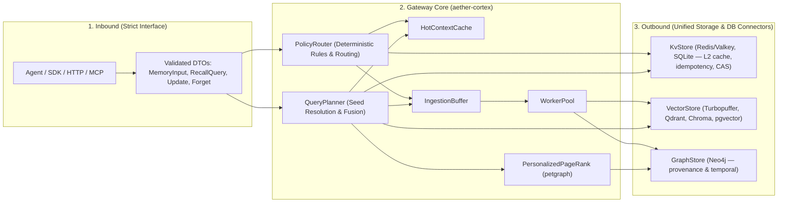

# Rust Migration Architecture & Design Blueprint

This document defines the target architecture and `aether-core` contracts for rewriting **Aether SDK** in Rust as a high-performance **AI Agent Memory Gateway**.

---

## 1. Product Scope & Core Design Decisions

1. **Unified Memory Storage SDK (`aether-sdk`)**: Aether is a unified AI memory gateway SDK that lets applications connect to any AI memory storage or database—such as **Turbopuffer, Neo4j, Qdrant, Chroma, and pgvector**—through one canonical inbound interface, with built-in routing, tenant isolation, hot caching, write-behind buffering, and resilient outbound connectors.
2. **No Document Parsing or Model Inference in Core**: Document-parsing pipelines (`docling`, `ParsingResource`, `IngestionResource`, `BrainResource`) and LLM/embedding model adapters (`LlmAdapter`, `EmbeddingAdapter`) are **excluded** from the core SDK. Aether does not own LLM prompts, token billing, or model SDKs.
3. **Strict Inbound Boundary (Caller-Constructed Input)**: Callers construct and submit Aether's canonical structured memory types (`MemoryInput`, `Entity`, `Relation`, `RecallQuery`, optional pre-computed `embedding`) through a validated inbound interface.
4. **Heavily Engineered Outbound Storage Layer**: The primary engineering investment is in the unified outbound connector layer (`VectorStore` for Turbopuffer, Qdrant, Chroma, pgvector; `GraphStore` for Neo4j) behind a shared resilience, batching, and observability stack.

---

## 2. Three-Pillar Gateway Architecture



Key data-flow guarantees:
- **Write-Behind Durability**: `IngestionBuffer → WorkerPool → Outbound Backends` handles durable async persistence. Callers choose `WriteDurability::Buffered` or `WriteDurability::WaitFlush`, and `MemoryManager::flush()` / `shutdown()` drain in-flight writes cleanly.
- **Read-Your-Writes**: `QueryPlanner` merges un-flushed entries from `HotContextCache` / `IngestionBuffer` (or awaits a flush barrier when `ConsistencyMode::ReadYourWrites` is requested).
- **Zero-LLM Hot Path**: `PolicyRouter` is strictly deterministic (schema validation, embedding-dimension checks, content-hash deduplication, routing rules).

---

## 3. Rust Workspace Layout

```text
aether/
├── Cargo.toml                  # Workspace manifest
└── crates/
    ├── aether-core/            # Newtypes, inbound DTOs, FilterExpr, TemporalFilter, AetherError, object-safe traits
    ├── aether-cortex/          # Gateway core (PolicyRouter, Buffer, WorkerPool, HotCache, QueryPlanner, PPR)
    ├── aether-adapters/        # Feature-gated outbound backends & middleware (Traced, Resilient, Timeout, Batcher)
    └── aether-sdk/             # Public facade (MemoryInbound / MemoryManager) & optional PyO3/server bindings
```

---

## 4. Inbound Interface & Domain Types (`aether-core`)

All I/O and tenant boundaries use strongly typed newtypes and portable ASTs:

```rust
pub struct ProjectId(String);  // validated non-empty
pub struct MemoryId(pub Uuid);
pub struct EntityId(String);   // validated non-empty; canonical slug or caller ID
```

### Canonical DTOs
- **`MemoryTier`**: `Episodic` | `Semantic` *(default)* | `Procedural` | `Profile`
- **`MemoryScope`**: `Project` *(default)* | `User` | `Session` | `Global`
- **`WriteDurability`**: `Buffered` *(default)* | `WaitFlush`
- **`ConsistencyMode`**: `Eventual` | `ReadYourWrites` *(default)*
- **`RecallMode`**: `Vector` | `Graph` | `Hybrid` *(default)*
- **`MemoryReceipt`**: `{ memory_id: MemoryId, state: ReceiptState /* Buffered | Persisted */, version: u64 }`
- **`Entity`**: `{ id: EntityId, name: String, entity_type: String }`
- **`Relation`**: `{ source: EntityId, target: EntityId, relation_type: String, valid_at: DateTime<Utc>, invalid_at: Option<DateTime<Utc>> }`
- **`MemoryInput`**: `project_id`, `content`, `embedding: Option<Vec<f32>>`, `entities`, `relations`, `tier`, `scope`, `durability`, `idempotency_key: Option<String>`, `metadata: Value`
- **`MemoryItem`**: the stored form of `MemoryInput` plus `id: MemoryId`, `version: u64` (optimistic CAS), `created_at`, `updated_at`
- **`MemoryUpdate`**: `{ content, embedding, metadata, expected_version: Option<u64> }` (all optional)
- **`FilterExpr`**:
  ```rust
  pub enum FilterExpr {
      Eq { field: String, value: FilterValue },
      In { field: String, values: Vec<FilterValue> },
      Range { field: String, gte: Option<f64>, lte: Option<f64> },
      And(Vec<FilterExpr>),
      Or(Vec<FilterExpr>),
  }
  ```
- **`TemporalFilter`**: `{ as_of: Option<DateTime<Utc>>, active_only: bool }`
- **`RecallQuery`**:
  - `project_id: ProjectId`, `query: String`, `query_vector: Option<Vec<f32>>`, `top_k: usize`
  - `mode: RecallMode`, `hops: u8`, `per_node_limit: usize`
  - `seed_entities: Vec<EntityId>` (caller-supplied PPR seeds)
  - `temporal: TemporalFilter`, `filters: Option<FilterExpr>`, `consistency: ConsistencyMode`
- **`RecallResult`**: `{ hits: Vec<RecallHit>, subgraph: Subgraph }`

### Inbound Operations (`MemoryInbound` Trait)
All transports (Rust SDK, `PyO3`, HTTP/gRPC server, MCP server) delegate to an object-safe `MemoryInbound` trait so validation, `ProjectId` scoping, and `tracing` spans are implemented **once**:

```rust
#[async_trait::async_trait]
pub trait MemoryInbound: Send + Sync {
    async fn remember(&self, input: MemoryInput) -> Result<MemoryReceipt>;
    async fn recall(&self, query: RecallQuery) -> Result<RecallResult>;
    async fn update(&self, project_id: &ProjectId, memory_id: MemoryId, patch: MemoryUpdate) -> Result<MemoryReceipt>;
    async fn forget(&self, project_id: &ProjectId, memory_id: MemoryId) -> Result<()>;
    async fn flush(&self) -> Result<()>;
    async fn shutdown(&self) -> Result<()>;
}
```

Durability is a field on `MemoryInput` and the expected version is a field on `MemoryUpdate`, not separate arguments.

---

## 5. Outbound Connections (`aether-core` traits + `aether-adapters`)

See [Connectors Architecture](./connectors.md) for the full middleware stack (`Traced<Resilient<Timeout<T>>>`), storage driver layout, error classification, and contract test harness.

All outbound traits inherit `OutboundConnector` (`name`, `capabilities`, `health_check`, `close`) and enforce `ProjectId` isolation at the trait boundary:

- **`KvStore: OutboundConnector`**: Unified L2 working-memory / key-value contract for **Redis/Valkey** and **SQLite** (`get`, `put` with TTL, `put_if_absent` for atomic idempotency, `cas_update` for distributed optimistic concurrency, `recent`, `delete`).
- **`VectorStore: OutboundConnector`**: Unified vector storage contract for **Turbopuffer, Qdrant, Chroma, pgvector**, etc. (`initialize(ns, dimensions, metric)`, `upsert_batch(ns, records)`, `delete(ns, ids)`, `search(ns, query_vector, top_k, filter)`).
- **`GraphStore: OutboundConnector`**: Unified graph storage contract for **Neo4j**, etc. (`upsert_entities(ns, entities)`, `upsert_relations(ns, source_memory_id, relations)`, `retract_memory_facts(ns, source_memory_id, invalidated_at)`, `neighborhood(ns, seeds, hops, per_node_limit, temporal)`). *(Raw `execute_query` is excluded to prevent tenant bypasses.)*
- **`InMemoryBackend`** *(test/dev only)*: Lightweight in-memory `KvStore` + `VectorStore` + `petgraph` `GraphStore` for `cargo test` and local dry-runs without Docker.

---

## 6. Status & Known Gaps

This document describes the target design.
Parts of it are not implemented yet: there is no `WorkerPool` (flushes run only on demand), `PolicyRouter` does not check embedding dimensions or content hashes, and PPR output does not yet influence ranking.
The [Roadmap](../about/roadmap.md) tracks the real status of each component and the hardening work that comes before production drivers.
