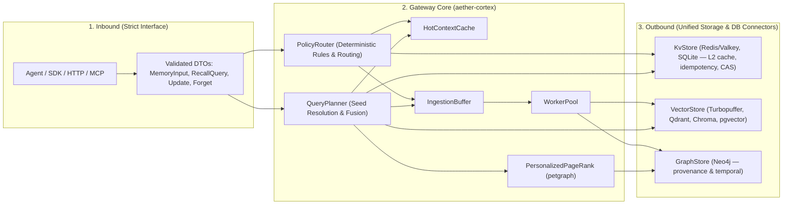

# Rust Migration Architecture & Design Blueprint

This document defines the target architecture and `aether-core` contracts for rewriting **Aether SDK** in Rust as a high-performance **AI Agent Memory Gateway**.

---

## 1. Product Scope & Core Design Decisions

1. **Unified Memory Storage SDK (`aether-sdk`)**: Aether is a unified AI memory gateway SDK that lets applications connect to any AI memory storage or database—such as **Turbopuffer, Neo4j, Qdrant, Chroma, and pgvector**—through one canonical inbound interface, with built-in routing, tenant isolation, hot caching, write-behind buffering, and resilient outbound connectors.
2. **No Document Parsing or Model Inference in Core**: Document-parsing pipelines (`docling`, `ParsingResource`, `IngestionResource`, `BrainResource`) and LLM/embedding model adapters (`LlmAdapter`, `EmbeddingAdapter`) are **excluded** from the core SDK. Aether does not own LLM prompts, token billing, or model SDKs.
3. **Strict Inbound Boundary (Caller-Constructed Input)**: Callers construct and submit Aether's canonical structured memory types (`MemoryInput`, `Entity`, `Relation`, `RecallQuery`, optional pre-computed `embedding`) through a validated inbound interface.
4. **Heavily Engineered Outbound Storage Layer**: The primary engineering investment is in the unified outbound connector layer (`VectorStore` for Turbopuffer, Qdrant, Chroma, pgvector; `GraphStore` for Neo4j) behind a shared resilience, batching, and observability stack.

---

## 2. Three-Pillar Gateway Architecture



Key data-flow guarantees:
- **Write-Behind Durability**: `IngestionBuffer → WorkerPool → Outbound Backends` handles durable async persistence. Callers choose `WriteDurability::Buffered` or `WriteDurability::Sync`, and `MemoryManager::flush()` / `shutdown()` drain in-flight writes cleanly.
- **Read-Your-Writes**: `QueryPlanner` merges un-flushed entries from `HotContextCache` / `IngestionBuffer` (or awaits a flush barrier when `ConsistencyMode::ReadYourWrites` is requested).
- **Zero-LLM Hot Path**: `PolicyRouter` is strictly deterministic (schema validation, embedding-dimension checks, content-hash deduplication, routing rules).

---

## 3. Rust Workspace Layout

```text
aether/
├── Cargo.toml                  # Workspace manifest
└── crates/
    ├── aether-core/            # Newtypes, inbound DTOs, FilterExpr, TemporalFilter, AetherError, object-safe traits
    ├── aether-cortex/          # Gateway core (PolicyRouter, Buffer, WorkerPool, HotCache, QueryPlanner, PPR)
    ├── aether-adapters/        # Feature-gated outbound backends & middleware (Traced, Resilient, Timeout, Batcher)
    └── aether-sdk/             # Public facade (MemoryInbound / MemoryManager) & optional PyO3/server bindings
```

---

## 4. Inbound Interface & Domain Types (`aether-core`)

All I/O and tenant boundaries use strongly typed newtypes and portable ASTs:

```rust
pub struct ProjectId(pub String);
pub struct MemoryId(pub Uuid);
pub struct EntityId(pub String); // Canonical deterministic slug or caller ID
```

### Canonical DTOs
- **`MemoryType`**: `Working` | `Episodic` | `Semantic`
- **`MemoryAction`**: `Add` | `Update` | `Delete` | `Ignore`
- **`WriteDurability`**: `Buffered` | `Sync`
- **`ConsistencyMode`**: `Eventual` | `ReadYourWrites`
- **`MemoryReceipt`**: `{ id: MemoryId, status: ReceiptStatus /* Buffered | Persisted */, version: u64 }`
- **`Entity`**: `{ id: EntityId, name: String, entity_type: String, description: Option<String> }`
- **`Relation`**: `{ source: EntityId, target: EntityId, relation_type: String, valid_at: Option<DateTime<Utc>>, invalid_at: Option<DateTime<Utc>>, description: Option<String> }`
- **`MemoryItem`**:
  - `id: MemoryId`, `project_id: ProjectId`, `version: u64` (optimistic CAS)
  - `content: String`, `idempotency_key: String`, `memory_type: MemoryType`
  - `entities: Vec<Entity>`, `relations: Vec<Relation>`
  - `significance: f32`, `created_at: DateTime<Utc>`, `updated_at: DateTime<Utc>`
  - `metadata: Value`, `embedding: Option<Vec<f32>>` (validated against configured `dimensions` when present)
- **`FilterExpr`**:
  ```rust
  pub enum FilterExpr {
      Eq { field: String, value: FilterValue },
      In { field: String, values: Vec<FilterValue> },
      Range { field: String, gte: Option<f64>, lte: Option<f64> },
      And(Vec<FilterExpr>),
      Or(Vec<FilterExpr>),
  }
  ```
- **`TemporalFilter`**: `{ as_of: Option<DateTime<Utc>>, active_only: bool }`
- **`RecallQuery`**:
  - `project_id: ProjectId`, `query: String`, `query_vector: Option<Vec<f32>>`, `top_k: usize`
  - `mode: RetrievalMode` (`Hybrid` | `Vector` | `Graph`)
  - `seed_entities: Vec<EntityId>` (caller-supplied PPR seeds, supplemented by `EntityId`s from top-k vector hits)
  - `temporal: TemporalFilter`, `filters: Option<FilterExpr>`, `consistency: ConsistencyMode`

### Inbound Operations (`MemoryInbound` Trait)
All transports (Rust SDK, `PyO3`, HTTP/gRPC server, MCP server) delegate to an object-safe `MemoryInbound` trait so validation, `ProjectId` scoping, and `tracing` spans are implemented **once**:

```rust
#[async_trait::async_trait]
pub trait MemoryInbound: Send + Sync {
    async fn remember(&self, input: MemoryInput, durability: WriteDurability) -> Result<MemoryReceipt>;
    async fn remember_batch(&self, inputs: Vec<MemoryInput>, durability: WriteDurability) -> Result<Vec<MemoryReceipt>>;
    async fn recall(&self, query: RecallQuery) -> Result<ContextResult>;
    async fn update(&self, ns: &ProjectId, id: MemoryId, expected_version: u64, patch: MemoryPatch) -> Result<MemoryReceipt>;
    async fn forget(&self, ns: &ProjectId, id: MemoryId) -> Result<()>;
    async fn flush(&self) -> Result<()>;
    async fn shutdown(&self) -> Result<()>;
}
```

---

## 5. Outbound Connections (`aether-core` traits + `aether-adapters`)

See [Connectors Architecture](./connectors.md) for the full middleware stack (`Traced<Resilient<Timeout<T>>>`), storage driver layout, error classification, and contract test harness.

All outbound traits inherit `OutboundConnector` (`name`, `capabilities`, `health_check`, `close`) and enforce `ProjectId` isolation at the trait boundary:

- **`KvStore: OutboundConnector`**: Unified L2 working-memory / key-value contract for **Redis/Valkey** and **SQLite** (`get`, `put` with TTL, `put_if_absent` for atomic idempotency, `cas_update` for distributed optimistic concurrency, `recent`, `delete`).
- **`VectorStore: OutboundConnector`**: Unified vector storage contract for **Turbopuffer, Qdrant, Chroma, pgvector**, etc. (`initialize(ns, dimensions, metric)`, `upsert_batch(ns, records)`, `delete(ns, ids)`, `search(ns, query_vector, top_k, filter)`).
- **`GraphStore: OutboundConnector`**: Unified graph storage contract for **Neo4j**, etc. (`upsert_entities(ns, entities)`, `upsert_relations(ns, source_memory_id, relations)`, `retract_memory_facts(ns, source_memory_id, invalidated_at)`, `neighborhood(ns, seeds, hops, per_node_limit, temporal)`). *(Raw `execute_query` is excluded to prevent tenant bypasses.)*
- **`InMemoryBackend`** *(test/dev only)*: Lightweight in-memory `KvStore` + `VectorStore` + `petgraph` `GraphStore` for `cargo test` and local dry-runs without Docker.

---

## 6. TDD & Phased Migration Roadmap

All implementation follows **Red → Green → Refactor** (see `AGENTS.md`):

1. **Phase 1 — `aether-core` (Contracts & Validation)**:
   - Implement newtypes, inbound DTOs, `FilterExpr`, `TemporalFilter`, `AetherError` (`Transient` vs `Permanent`), and object-safe `MemoryInbound` / `OutboundConnector` traits with unit tests.
2. **Phase 1.5 — `InMemoryBackend` & Contract Suite**:
   - Implement the in-memory test backend (`VectorStore` + `petgraph` `GraphStore`) and the shared contract test suite before building `aether-cortex`.
3. **Phase 2 — `aether-cortex` (Gateway Core)**:
   - Implement `PolicyRouter`, `HotContextCache`, `IngestionBuffer` + `WorkerPool`, `QueryPlanner` (seed resolution + read-your-writes merge), and `PersonalizedPageRank` (`petgraph`).
4. **Phase 3 — `aether-adapters` (Production Storage & DB Connectors)**:
   - Implement the shared `middleware/` stack (`Resilient`, `Timeout`, `Batcher`, `Traced`) and feature-gated `turbopuffer`, `qdrant`, `neo4j`, `chroma`, and `pgvector` connectors.
5. **Phase 4 — `aether-sdk` (Facade, Lifecycle & Heavy E2E)**:
   - Implement `MemoryManager` (`flush`, `shutdown`), heavy concurrency/read-your-writes E2E tests, and optional `PyO3` / HTTP gateway bindings.
