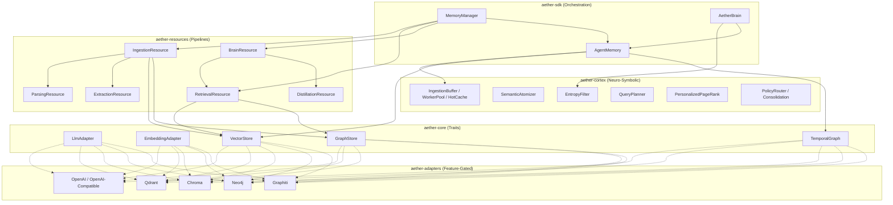

# Rust Migration Architecture & Design Blueprint

This document compiles the complete architecture, domain models, traits, and component inventory of **Aether SDK** (`src/aether_sdk/`) as the reference blueprint for rewriting the project in Rust.

---

## 1. Proposed Rust Workspace Layout

A Cargo workspace cleanly decouples core abstractions from heavy infrastructure drivers using feature flags:

```text
aether/
├── Cargo.toml                  # Workspace manifest
└── crates/
    ├── aether-core/            # Domain types, error types, async traits (Protocols)
    ├── aether-cortex/          # Neuro-symbolic engine (entropy, atomizer, PPR, buffer, cache)
    ├── aether-resources/       # Pipeline logic (parsing, extraction, ingestion, retrieval, distillation)
    ├── aether-adapters/        # Feature-gated drivers (openai, qdrant, neo4j, chroma, etc.)
    └── aether-sdk/             # Public facade (MemoryManager, AetherBrain) & optional PyO3 bindings
```

---

## 2. Architecture Overview



---

## 3. Core Domain Types (`types/shared.py` → `aether-core`)

All Python Pydantic models and enums map directly to `serde`-serializable Rust structs and enums:

| Python Symbol | File | Rust Target | Notes |
| --- | --- | --- | --- |
| `EntityType` | `types/shared.py` | `enum EntityType` | `Person`, `Project`, `Goal`, `Date`, `Organization`, `Unknown`, `Incident`, `Code`, `Risk` |
| `RelationType` | `types/shared.py` | `enum RelationType` | `WORKS_ON`, `DEADLINE_AT`, `PARTNER_WITH`, `MENTIONED_IN`, `RELATED_TO`, `CALLS`, `CAUSES`, `MODIFIED`, `HAPPENED_AT`, `RISK_OF` |
| `IngestionStatus` | `types/shared.py` | `enum IngestionStatus` | `Pending`, `Processing`, `Completed`, `Failed` |
| `Document` | `types/shared.py` | `struct Document` | `id: Uuid`, `project_id: String`, `filename: String`, `content_type: String`, `content: String`, `status: IngestionStatus`, `created_at: DateTime<Utc>`, `metadata: Value` |
| `ExtractedEntity` | `types/shared.py` | `struct ExtractedEntity` | `name: String`, `entity_type: String`, `description: Option<String>` |
| `ExtractedRelation` | `types/shared.py` | `struct ExtractedRelation` | `source: String`, `target: String`, `relation_type: String`, `description: Option<String>` |
| `KnowledgeGraph` | `types/shared.py` | `struct KnowledgeGraph` | `entities: Vec<ExtractedEntity>`, `relations: Vec<ExtractedRelation>` |
| `ContextResult` | `types/shared.py` | `struct ContextResult` | `distilled_context: String`, `source_references: Vec<String>`, `mode: RetrievalMode` (`Hybrid`, `Vector`, `Graph`) |
| `MemoryType` | `cortex/memory/orchestrator.py` | `enum MemoryType` | `Episodic`, `Semantic`, `Working` |
| `MemoryItem` | `cortex/memory/orchestrator.py` | `struct MemoryItem` | `id: Uuid`, `content: String`, `memory_type: MemoryType`, `created_at: DateTime<Utc>`, `significance: f32`, `metadata: Value`, `embedding: Option<Vec<f32>>` |
| `MemoryAction` | `cortex/executive/policy.py` | `enum MemoryAction` | `Add`, `Update`, `Delete`, `Ignore` |
| `QueryComplexity` | `cortex/ecphory/planner.py` | `enum QueryComplexity` | `Simple`, `Complex` |

---

## 4. Core Traits (`core/protocols.py` → `aether-core`)

Every external dependency is inverted behind traits (`Send + Sync`, async via `async_trait` or RPITIT):

### `LlmAdapter` (from `LLMAdapterProtocol`)
- `generate_completion(messages: &[Message], options: &CompletionOptions) -> Result<String>`
- `generate_structured<T: DeserializeOwned>(messages: &[Message], schema: &Value, options: &CompletionOptions) -> Result<T>`

### `EmbeddingAdapter` (from `EmbeddingAdapterProtocol`)
- `embed_text(text: &str) -> Result<Vec<f32>>`
- `embed_batch(texts: &[&str]) -> Result<Vec<Vec<f32>>>`

### `VectorStore` (from `VectorStoreProtocol`)
- `initialize() -> Result<()>`
- `upsert(id: &str, vector: &[f32], metadata: &Value) -> Result<()>`
- `search(query_vector: &[f32], top_k: usize) -> Result<Vec<VectorSearchHit>>` (`id`, `score`, `metadata`)

### `GraphStore` (from `GraphStoreProtocol`)
- `execute_query(query: &str, params: Option<&Value>) -> Result<Vec<Value>>`
- `upsert_node(project_id: &str, name: &str, node_type: &str, properties: Option<&Value>) -> Result<()>`
- `upsert_relation(project_id: &str, source: &str, target: &str, rel_type: &str, properties: Option<&Value>) -> Result<()>`

### `TemporalGraph` (from `TemporalGraphProtocol`)
- `initialize() -> Result<()>`
- `close() -> Result<()>`
- `add_episode(content: &str, source_id: &str) -> Result<()>`
- `add_triplet(source: &Node, edge: &Edge, target: &Node) -> Result<()>`
- `search(query: &str) -> Result<Vec<Value>>`

---

## 5. Component Inventory

### Orchestration Layer (`aether-sdk`)
- **`MemoryManager`** (`memory.py`): Wires adapters into `AgentMemory` and all `Resources`; exposes `ingest_text()` and `ask()`.
- **`AetherBrain`** (`brain.py`): Zero-shot agent loop (`Recall → Reason → Act`, max 5 turns) that parses `<think>...</think>` and `<tool_call>...</tool_call>` blocks, runs `SimpleEntropyFilter`, and emits `BrainEvent`s to `BrainMonitor` observers.

### Resource Layer (`aether-resources`)
- **`ParsingResource`** (`resources/parsing.py`): Document parsing into clean text.
- **`ExtractionResource`** (`resources/extraction.py`): LLM-driven entity and relation extraction into `KnowledgeGraph`.
- **`IngestionResource`** (`resources/ingestion.py`): Orchestrates parsing, chunking, embedding, vector upsert, and optional graph extraction/upsert.
- **`RetrievalResource`** (`resources/retrieval.py`): Hybrid retrieval combining `VectorStore` similarity search and `GraphStore` traversal.
- **`DistillationResource`** (`resources/distillation.py`): Synthesizes retrieved context into concise answers via `LlmAdapter`.
- **`BrainResource`** (`resources/brain.py`): Coordinates `RetrievalResource` + `DistillationResource` for Q&A.
- **`HippoRAGResource`** (`resources/hipporag_resource.py`) & `integrations/hipporag.py`: Integration bridge for HippoRAG-style graph retrieval.

### Cortex Layer (`aether-cortex`)
- **Perception**:
  - `SimpleEntropyFilter` (`cortex/perception/entropy.py`): Filters low-information inputs before storage.
  - `SemanticAtomizer` (`cortex/perception/atomizer.py`): De-linearizes conversational text into self-contained atomic facts.
- **Memory**:
  - `AgentMemory` (`cortex/memory/orchestrator.py`): Coordinates Episodic (`VectorStore`), Semantic (`TemporalGraph`), and Working memory.
  - `IngestionBuffer` (`buffer.py`), `WorkerPool` (`worker.py`), `HotContextCache` (`cache.py`), `EpisodicMemory` (`episodic.py`), `SemanticMemory` (`semantic.py`), `LazyMemory` (`lazy.py`).
- **Ecphory (Retrieval Planning & Graph Activation)**:
  - `QueryPlanner` (`cortex/ecphory/planner.py`): Classifies query complexity (`Simple` vs `Complex`) and builds retrieval plans.
  - `PersonalizedPageRank` (`cortex/ecphory/ppr.py`): Spreading activation over knowledge graph neighborhoods.
- **Executive**:
  - `PolicyRouter` (`cortex/executive/policy.py`): Evaluates candidate memories (`Add`, `Update`, `Delete`, `Ignore`).
  - `Consolidation` (`cortex/executive/consolidation.py`): Background consolidation of buffered memories.

### Adapters Layer (`aether-adapters`)
- `OpenAIAdapter` (`adapters/openai.py`)
- `LiteLLMAdapter` (`adapters/litellm.py`) — in Rust, replace with an OpenAI-compatible HTTP client (`reqwest`) + provider presets.
- `QdrantAdapter` (`adapters/qdrant.py`) — `qdrant-client` crate.
- `ChromaAdapter` (`adapters/chroma.py`)
- `Neo4jAdapter` (`adapters/neo4j.py`) — `neo4rs` crate.
- `GraphitiAdapter` (`adapters/graphiti/adapter.py`)

---

## 6. Known Python Prototype Gaps to Fix in Rust

1. **Unify sync/async trait methods**: `LLMAdapterProtocol` defines `generate_completion`, while `AetherBrain` calls `await self.llm.chat_completion(...)`. Standardize all I/O traits in `aether-core` as `async fn` from day one.
2. **Replace MVP stubs with real implementations**:
   - `PersonalizedPageRank` currently returns mock scores; implement real in-memory PPR using `petgraph`.
   - `QueryPlanner` uses a keyword/length heuristic; support both deterministic heuristics and optional LLM-backed planning.
   - `MemoryManager.create_conversation` is a stub; design an explicit `Conversation` session state struct.
3. **Feature-gate heavy dependencies**: Keep `aether-core` and `aether-cortex` pure Rust with zero database/ML runtime dependencies. Gate Qdrant, Neo4j, HTTP LLM clients, and local embeddings behind Cargo features.
4. **Structured error handling**: Replace silent fallbacks/empty returns (e.g., missing Neo4j driver returning `[]`) with typed `thiserror` enums.

---

## 7. Phased Migration Roadmap

1. **Phase 1 — `aether-core`**: Implement all domain structs/enums (`serde`), `AetherError`, and async traits (`LlmAdapter`, `EmbeddingAdapter`, `VectorStore`, `GraphStore`, `TemporalGraph`) with in-memory mock implementations for unit testing.
2. **Phase 2 — `aether-cortex`**: Port `IngestionBuffer` (using `tokio::sync::mpsc`), `HotContextCache`, `SimpleEntropyFilter`, `PolicyRouter`, and `PersonalizedPageRank` (`petgraph`).
3. **Phase 3 — `aether-resources`**: Implement `ParsingResource`, `ExtractionResource`, `IngestionResource`, `RetrievalResource`, `DistillationResource`, and `BrainResource` against `aether-core` traits.
4. **Phase 4 — `aether-adapters` & `aether-sdk`**: Implement feature-gated `openai`, `qdrant`, and `neo4j` adapters, expose `MemoryManager` and `AetherBrain`, and optionally add `PyO3` bindings if Python consumers remain supported.
