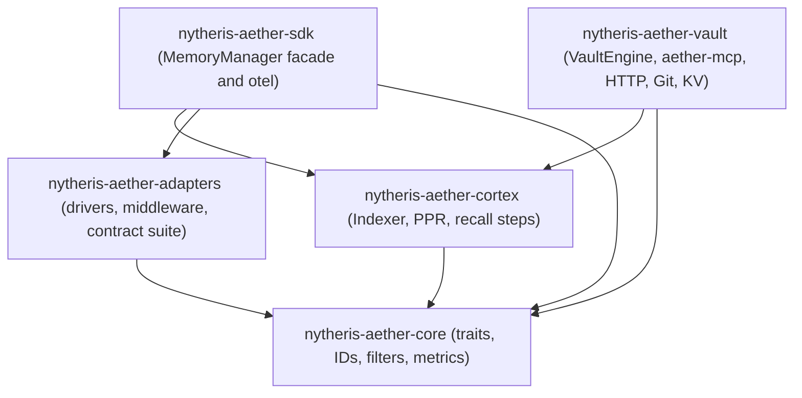
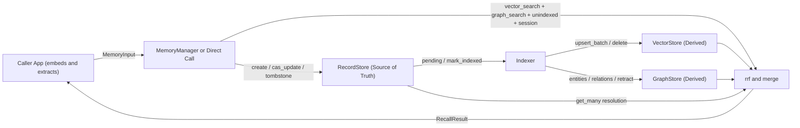
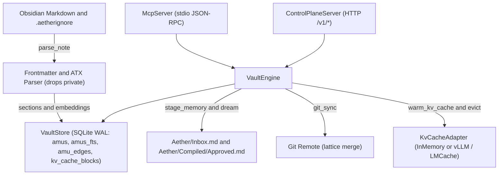

# Concepts Overview: Model-Free & Pieces-First

Aether separates storage durability and graph or vector retrieval from model inference. This section explains why the SDK stays model-free, why capabilities are exposed as independent functions and traits before `MemoryManager`, and how both the SDK pipeline and the Obsidian vault compiler move data.

## Why Aether separates storage from inference models

Embedding models, entity extractors, and LLM routers change frequently and often run behind application-specific rate limits, privacy boundaries, or custom batching loops. When a memory framework hides model calls inside `remember` or `recall`, your application loses control over token cost, prompt formatting, and retry placement.

Aether stays model-free across the four SDK crates (`nytheris-aether-core`, `nytheris-aether-cortex`, `nytheris-aether-adapters`, and `nytheris-aether-sdk`). Your code calls its own embedder or extractor, then hands Aether plain structs (`MemoryInput`, `Entity`, `Relation`, `RecallQuery`). Even inside `nytheris-aether-vault`, local embeddings default to zero-network `HashedNgramEmbedder` behind a swappable `Embedder` trait rather than bundling an LLM client.

## Why pieces-first beats a sealed gateway

Early memory libraries act as a framework that calls your hooks at fixed points. That inversion of control breaks as soon as you need to reorder steps, skip a graph database, or run a custom reranker between vector search and prompt assembly.

Aether builds from small public pieces upward:

1. **Arguments instead of shared context.** Every function takes explicit store trait references and plain data values (`&dyn VectorStore`, `&ProjectId`, `Vec<Candidate>`).
2. **No hidden background work.** Nothing spawns timers or background tasks unless you call `Indexer::spawn`, pass `.background_indexing(...)` to `MemoryManager::builder`, or set `watch_interval` on `VaultConfig`.
3. **No private facade powers.** `MemoryManager` depends on `nytheris-aether-cortex` and `nytheris-aether-adapters` through the same public API any caller sees.

The trade-off is a wider public API, which Aether keeps manageable by passing ordinary value types (`MemoryItem`, `Candidate`, `Subgraph`) between every stage.

## Five-crate dependency structure

Each crate has one clear boundary and depends only downward.

- `nytheris-aether-core` holds zero I/O. It defines validated IDs, `DistanceMetric`, `FilterExpr`, DTOs, `AetherError`, and the `OutboundConnector`, `RecordStore`, `VectorStore`, and `GraphStore` traits.
- `nytheris-aether-cortex` implements `Indexer`, `PersonalizedPageRank`, `graph_scores`, and `recall::*` functions against core traits.
- `nytheris-aether-adapters` implements `InMemoryBackend`, `Batcher`, `Timeout`, `Resilient`, `Traced`, the `contract` test suite, and feature-gated drivers (`sqlite`, `redis`, `qdrant`, `pgvector`, `chroma`, `turbopuffer`, `neo4j`).
- `nytheris-aether-sdk` composes `MemoryManager` and optional OpenTelemetry initialization (`otel`).
- `nytheris-aether-vault` embeds `nytheris-aether-core` and `nytheris-aether-cortex` on top of a single-file SQLite WAL schema to compile Obsidian vaults, serve MCP and HTTP endpoints, sync Git team vaults, and warm GPU KV caches.

## SDK write, sync, and recall pipeline

In the core SDK, `RecordStore` is the single durable write target, while `VectorStore` and `GraphStore` are derived indexes reconciled asynchronously or on demand.

## Obsidian vault compiler pipeline

`nytheris-aether-vault` adapts the same pattern to local Markdown files, replacing remote vector and graph services with a unified SQLite WAL database while keeping verbatim note text on disk.

Explore the deeper mechanics across the concept pages in this section:

- [System of Record, Derived Indexes & Consistency](./storage-and-consistency.md)
- [Scopes, Tiers & Temporal Forgetting](./scopes-tiers-and-forgetting.md)
- [Hybrid Recall, Personalized PageRank & RRF](./hybrid-recall-and-ppr.md)
- [Obsidian AMUs, Prefix Caching & KV-Tensor Warming](./vault-amu-and-kv-cache.md)
