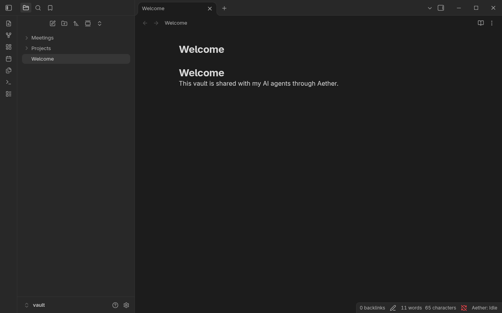
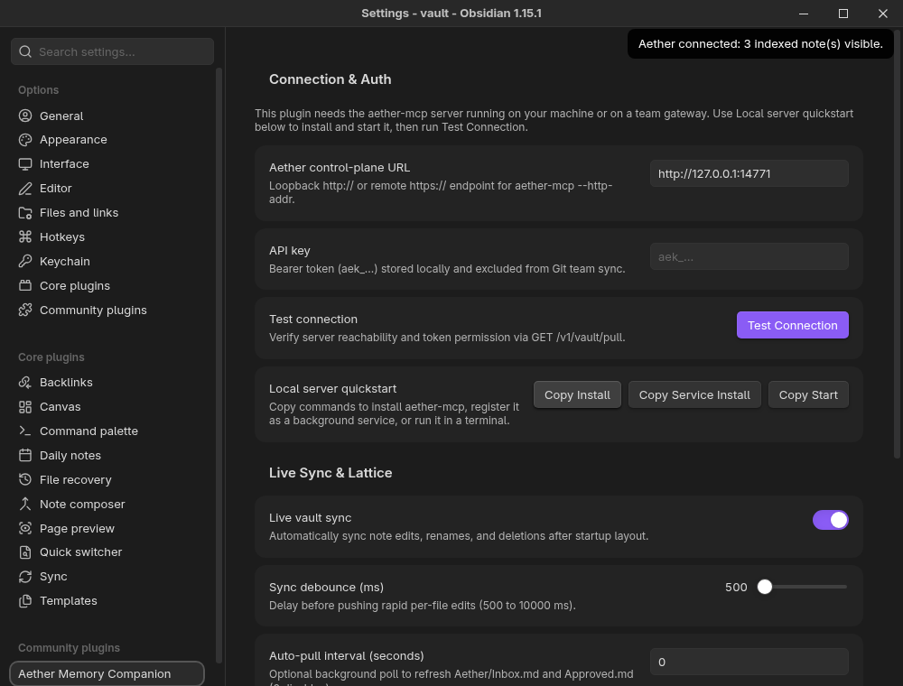
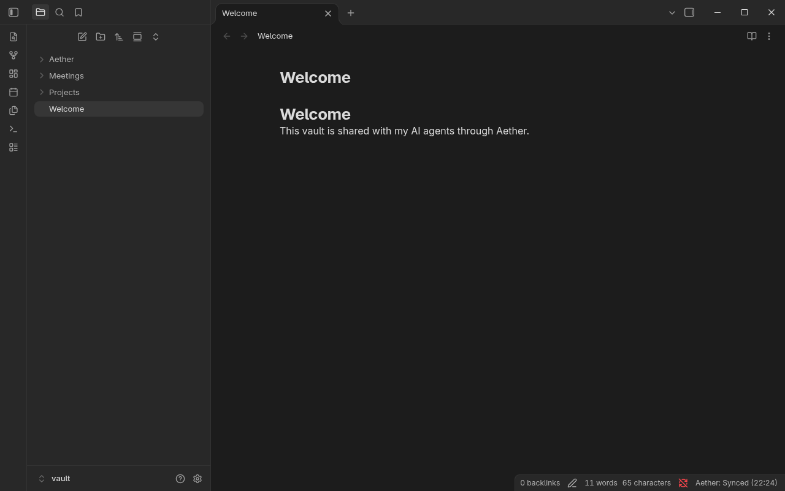
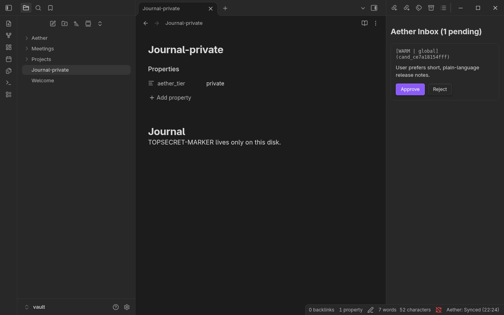
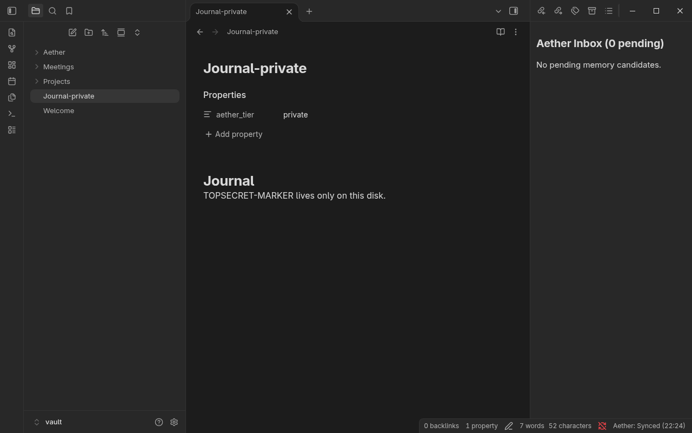

# Obsidian and AI agent walkthrough

See Aether Memory Companion working in a real Obsidian Desktop vault.
Every screenshot and clip on this page was recorded from Obsidian 1.15.1 talking to a real `aether-mcp` server.
The capture is scripted, so it can be regenerated when the UI changes (`node scripts/capture_obsidian_guide.mjs <out_dir>`).

For install commands and every setting, read [Set up Obsidian and an AI agent with Aether](./obsidian-setup.md).

## Watch the full demo: Obsidian and Cursor together

This 90 second recording shows both sides at once: Obsidian with Aether Memory Companion on the left and the Cursor Agents window on the right, working on the same vault through `aether-mcp`.
The agent's replies are real and unedited, so the wording varies between recordings.

<video controls muted playsinline width="100%" poster={require('../assets/obsidian-guide/obsidian-cursor-demo-poster.png').default}>
  <source src={require('../assets/obsidian-guide/obsidian-cursor-demo.webm').default} type="video/webm" />
  <source src={require('../assets/obsidian-guide/obsidian-cursor-demo.mp4').default} type="video/mp4" />
</video>

It covers the primary use cases in order:

1. You write a note in Obsidian and it syncs to `aether-mcp` automatically.
2. The Cursor agent recalls that note through the `aether_recall` MCP tool.
3. A note marked `aether_tier: private` stays on disk and the agent cannot find it.
4. The agent proposes a new memory with `aether_stage_memory`.
5. You approve it in the Obsidian Inbox pane.
6. The approved memory is now recallable by the agent.

Your own notes sync automatically.
Only facts an agent proposes wait for your approval before they become memory.

The steps below show each part in more detail.

## 1. Trust the vault and enable the plugin

The first time you open a vault that contains community plugins, Obsidian asks whether you trust its author.
Choose **Trust author and enable plugins**.

## 2. Connect to aether-mcp

Open **Settings**, then **Aether Memory Companion**.
Leave the URL at `http://127.0.0.1:14771` for a local server and select **Test connection**.
A notice reports how many notes the server can see.

If the notice is an error, start the server first with the **Local server quickstart** buttons.

## 3. Sync your vault

Run **Sync vault with Aether** from the Command Palette.
The status bar changes from `Aether: Idle` to `Aether: Synced (HH:mm)`, and a notice reports updated, indexed, removed, and private-skipped counts.

<video controls muted loop playsinline width="100%" src={require('../assets/obsidian-guide/03-sync.webm').default}></video>

## 4. Keep a note private

Add `aether_tier: private` to a note's frontmatter.
The note stays on your disk and the plugin never sends its body to the server.

<video controls muted loop playsinline width="100%" src={require('../assets/obsidian-guide/05-private-note.webm').default}></video>

An agent that searches for the note's contents does not find it.
The query below looks for a marker that only exists in the private note, and the recall result does not contain it.

Public notes are recalled normally.

## 5. Review what your agent wants to remember

When an agent calls `aether_stage_memory`, the fact waits in your Inbox until you approve it.
Run **Open Aether inbox review** and select **Approve** or **Reject**.

<video controls muted loop playsinline width="100%" src={require('../assets/obsidian-guide/08-inbox-approve.webm').default}></video>

## 6. Recover when the server is down

If `aether-mcp` stops, the status bar shows `Aether: Offline` and your notes stay untouched.
Start the server again and run the sync command to return to `Aether: Synced`.

<video controls muted loop playsinline width="100%" src={require('../assets/obsidian-guide/11-offline-recovery.webm').default}></video>

## Next steps

- Connect an MCP client such as Claude Desktop in [Step 5 of the setup guide](./obsidian-setup.md).
- Share a vault with a team in [Team Git, auth, and KV warming](../series/05-team-git-auth-and-kv-warming.md).
