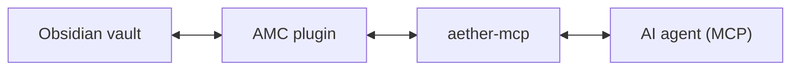

# Aether documentation

Aether gives your AI agents memory from your Obsidian vault.
**AMC** (Aether Memory Companion) is the Obsidian plugin.
**`aether-mcp`** is the local server that indexes your notes and serves them to any MCP-compatible agent, such as Cursor, Claude Desktop, Claude Code, or Antigravity.

- Your notes sync automatically.
- Notes marked `aether_tier: private` stay on your disk.
- Facts an agent proposes wait in an inbox until you approve them.

## Start here

1. **[Quickstart](get-started/quickstart.md).** Get an agent recalling your notes in about five minutes.
2. **[Install aether-mcp](get-started/install-aether-mcp.md).** Installer, background service, or Docker.
3. **[Install AMC](get-started/install-amc.md).** Plugin install, connection, and first sync.
4. **[Connect an AI agent](get-started/connect-an-agent.md).** `stdio` or HTTP, and the three MCP tools.

## Guides

- **[AMC walkthrough](guides/amc-walkthrough.md).** Screenshots and a demo recorded from a real vault.
- **[Organize and protect your notes](guides/organize-and-protect-notes.md).** Tiers, private notes, `.aetherignore`, and `.aetherhot`.
- **[Review what your agent wants to remember](guides/review-agent-memories.md).** The inbox and Dream pass.
- **[Share a vault with a team](guides/team-and-remote-setup.md).** Authenticated gateway, scoped keys, and Git sync.
- **[Troubleshooting](guides/troubleshooting.md).** Connection, authentication, and sync problems.

## Reference

- **[aether-mcp CLI and MCP tools](reference/aether-mcp.md).** Flags, environment variables, subcommands, and tool schemas.
- **[HTTP API](reference/http-api.md).** All 19 control-plane endpoints and their roles.
- **[Vault files and frontmatter](reference/vault-files.md).** Frontmatter keys, `.aetherignore`, and `.aetherhot`.
- **[AMC plugin settings and commands](reference/amc-plugin.md).** Settings, commands, and status bar states.

## Build with the Rust SDK

Aether is also a model-free Rust SDK (`muninn-aether-*`) for record durability, vector search, temporal knowledge graphs, and prefix-cache-friendly MCP serving.

- **Learning series.** Five tutorials from [your first memory](series/01-quickstart-first-memory.md) to [team Git sync and KV warming](series/05-team-git-auth-and-kv-warming.md).
- **[Usage guide](sdk/usage.md)** and **[memory model](sdk/memory.md).** Snippets across all five SDK levels.
- **[Crates, traits and APIs](sdk/crates-and-apis.md)**, **[storage backends and flags](sdk/storage-backends-and-flags.md)**, and **[observability](sdk/observability.md).**

## Concepts and architecture

- **[Concepts overview](concepts/index.md).** The model-free, pieces-first design, scopes and tiers, hybrid recall, and KV-cache layout.
- **[Architecture and ADRs](architecture/index.md).** Design records for the SDK, connectors, hardening, and the vault server.

## Project

- **[Roadmap](about/roadmap.md)**
- **[Development guidelines](development/guidelines.md)**
- **[Submit AMC to the Obsidian directory](development/obsidian-directory-submission.md)**
