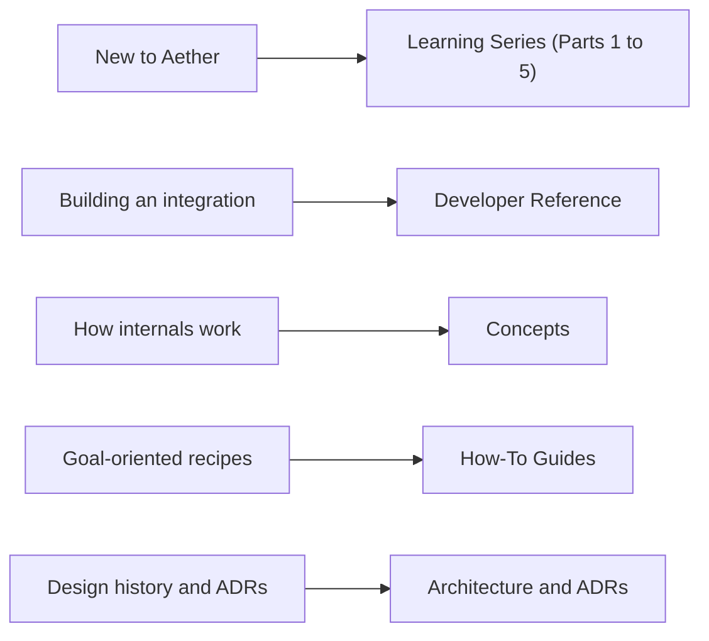

# Aether SDK Documentation

**Aether SDK** (`nytheris-aether-*`) is a model-free Rust memory SDK and Obsidian vault compiler. It unifies record durability, vector search, temporal knowledge graphs, and prefix-cache-friendly MCP serving without hiding control flow inside a framework.

## Choose your path

## Learning Series

Follow the five sequential tutorials from your first in-memory query to multi-agent Git vaults and GPU KV-tensor warming.

1. **[Part 1: Quickstart & Your First Memory](series/01-quickstart-first-memory.md).** Workspace layout, model-free boundary, and storing your first record and vector with `InMemoryBackend`.
2. **[Part 2: Mastering the Five Composable Levels](series/02-five-composable-levels.md).** Step-by-step progression across connectors, middleware, hybrid recall, `Indexer`, and `MemoryManager`.
3. **[Part 3: Production Storage Backends](series/03-production-storage-backends.md).** Running SQLite, Valkey, Qdrant, pgvector, Chroma, Turbopuffer, and Neo4j with `./scripts/dev-infra.sh`.
4. **[Part 4: Obsidian Vault Compiler & MCP Server](series/04-obsidian-vault-and-mcp.md).** Compiling Markdown notes, `Aether/Inbox.md` approvals, Dream consolidation, and `aether-mcp` over `stdio`.
5. **[Part 5: Team Git Sync, Scoped Auth & GPU KV Warming](series/05-team-git-auth-and-kv-warming.md).** Per-agent `ScopedApiKey` credentials, Git lattice sync, HTTPS Obsidian plugin setup, and vLLM and LMCache warming.

## Concepts

Read deep explanations of Aether's guarantees, scoring math, and cache layout.

- **[Concepts Overview: Model-Free & Pieces-First](concepts/index.md).** Architectural thesis, crate dependency graph, and SDK vs vault data flows.
- **[System of Record, Derived Indexes & Consistency](concepts/storage-and-consistency.md).** Versioned `RecordStore` truth, tombstones, `Indexer`, and `ReadYourWrites` vs `Eventual`.
- **[Scopes, Tiers & Temporal Forgetting](concepts/scopes-tiers-and-forgetting.md).** `Project`, `User`, and record-only `Session` isolation, update invariants, and `source_memory_id` retraction.
- **[Hybrid Recall, Personalized PageRank & RRF](concepts/hybrid-recall-and-ppr.md).** `DistanceMetric::score`, `FilterExpr`, `PersonalizedPageRank`, `recall::rrf`, `authority_weight`, and `CrossEncoderReranker`.
- **[Obsidian AMUs, Prefix Caching & KV-Tensor Warming](concepts/vault-amu-and-kv-cache.md).** `AmuId` derivation, `private` isolation, `[AETHER_HOT_PROFILE]`, PagedAttention and CacheBlend hashing, and eviction.

## How-To Guides

- **[Usage Guide](guides/usage.md).** Condensed snippets across all five SDK levels and `nytheris-aether-vault`.
- **[Memory Model & Consistency](guides/memory.md).** Quick overview of SDK scopes, durability modes, and vault memory units.
- **[Observability & OpenTelemetry](guides/observability.md).** Tracing span hierarchy and the one-line `otel` OTLP gRPC setup.

## Developer Reference

- **[Crates, Traits & API Reference](reference/crates-and-apis.md).** Validated newtypes, storage traits, `MemoryManager`, `VaultEngine`, and error variants.
- **[Storage Backends, Feature Flags & Configuration](reference/storage-backends-and-flags.md).** Cargo feature flags, connector configs, `ConnectorCapabilities`, and Docker ports.
- **[aether-mcp CLI, MCP Tools, HTTP API & Frontmatter](reference/aether-mcp-and-http-api.md).** CLI flags, JSON-RPC schemas, all 16 HTTP endpoints, frontmatter keys, and Obsidian commands.

## Architecture & ADRs

- **[Architecture Overview](architecture/index.md).** Five-level architecture summary across the five workspace crates.
- **[Connectors Architecture](architecture/connectors.md).** Outbound driver traits, middleware composition, and the shared contract test suite.
- **[Pieces-First SDK Design](architecture/sdk-design.md).** Design record for building from small public pieces up to `MemoryManager`.
- **[Phase 5 Hardening Design](architecture/hardening-design.md).** Hardening rationale for durable `RecordStore` state and derived indexes.
- **[M1 Vault & MCP Architecture](architecture/m1-vault-mcp-rationale.md).** Architectural decision record for `nytheris-aether-vault` and Milestones 1 to 3.
- **[Change Overview](architecture/change-overview.md).** Record of the pieces-first and hardening transition.

## Development & Roadmap

- **[Development Guidelines](development/guidelines.md).** Workspace rules, verification commands, and contract testing gates.
- **[Roadmap](about/roadmap.md).** Completed milestones across SDK, storage drivers, vault compiler, and team sync.
